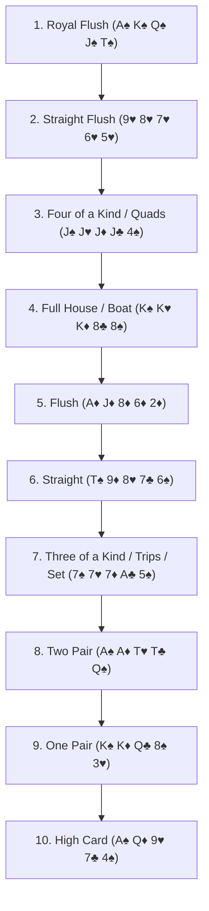
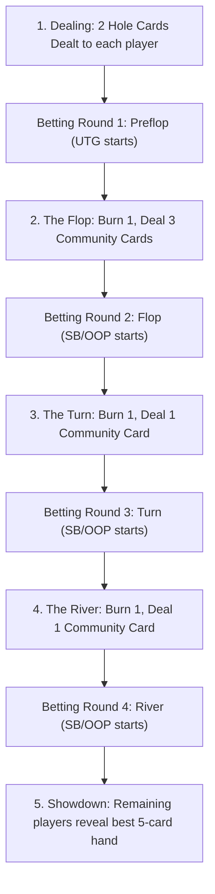

# Texas Hold'em: Complete Reference Guide & Fundamental Theory
*A comprehensive guide to rules, table dynamics, mathematical foundations, and strategic principles.*

---

## Table of Contents
1. [Introduction & Game Philosophy](#1-introduction--game-philosophy)
2. [Table Anatomy, Positions & Blinds](#2-table-anatomy-positions--blinds)
3. [Hand Rankings & Evaluation Mechanics](#3-hand-rankings--evaluation-mechanics)
4. [The Structure of a Hand (The Four Betting Streets)](#4-the-structure-of-a-hand-the-four-betting-streets)
5. [Betting Rules, Limits & Pot Management](#5-betting-rules-limits--pot-management)
6. [Fundamental Mathematics of Hold'em](#6-fundamental-mathematics-of-holdem)
7. [Core Strategic Principles (The Hold'em Bridge)](#7-core-strategic-principles-the-holdem-bridge)
8. [Glossary of Essential Terminology](#8-glossary-of-essential-terminology)

---

## 1. Introduction & Game Philosophy

No-Limit Texas Hold'em (NLHE) is the world's most widely played poker variant. While the basic mechanics can be learned in minutes, mastering the game requires deep understanding of probability, game theory, psychology, and risk management.

At its core, Texas Hold'em is a **game of incomplete information**. Unlike chess, where both players observe all pieces on the board at all times, poker challenges each player to deduce hidden information (opponents' private hole cards and intentions) from observable actions:
* Bet sizing and timing
* Board texture evolution
* Historical frequencies and player tendencies
* Positional dynamics

### The Hold'em vs. Omaha (PLO) Paradigm
In Texas Hold'em:
* Each player is dealt **2 private hole cards**.
* Up to **5 community cards** are dealt face-up on the board.
* To form a hand, a player may use **any combination** of their hole cards and board cards:
  * Both hole cards and 3 board cards
  * One hole card and 4 board cards
  * Zero hole cards and all 5 board cards ("playing the board")

*(Note: This is the fundamental contrast with Pot-Limit Omaha, detailed in Lesson 11 of your study companion, where a player is dealt 4 hole cards and **must** use exactly 2 hole cards and exactly 3 board cards).*

Because players have only 2 hole cards, there are exactly:
$$\binom{52}{2} = \frac{52 \times 51}{2} = 1,326 \text{ starting hand combinations}$$
This manageable state space makes Texas Hold'em the premier pedagogical foundation—the "Hold'em Bridge"—for mastering position, ranges, pot odds, and expected value before tackling high-complexity games like PLO (which has 270,725 starting combos).

---

## 2. Table Anatomy, Positions & Blinds

### 2.1 The Table Layout (6-Max vs. Full Ring)
In modern cash games, the **6-Max** format (6 players per table) is standard. In full ring games, 9 or 10 players participate. 

The seats rotate clockwise around the **Dealer Button (BTN)** after every hand:

```
                          [ Small Blind (SB) ]
                     /                            \
       [ Button (BTN) ]                          [ Big Blind (BB) ]
            |                                           |
       [ Cutoff (CO) ]                           [ Under the Gun (UTG) ]
                     \                            /
                         [ Hijack (HJ / MP) ]
```

### 2.2 Table Positions and Their Order of Action

| Position Code | Position Name | Preflop Action Order | Postflop Action Order | Strategic Character |
| :--- | :--- | :--- | :--- | :--- |
| **UTG** | Under the Gun | **1st** (Acts first) | 3rd to 6th | Tightest range. Maximum players left to act behind. |
| **HJ / MP** | Hijack / Middle Position | 2nd | 3rd to 5th | Moderately tight. Begins loosening hand selection. |
| **CO** | Cutoff | 3rd | 2nd to 4th | Wide range. Prime position to steal the blinds. |
| **BTN** | The Button | 4th | **Last** (Acts last on all postflop streets) | **Most profitable seat at the table.** Complete informational advantage. |
| **SB** | Small Blind | 5th | **1st** (Acts first postflop) | Out of position (OOP) the entire hand. Worst seat postflop. |
| **BB** | Big Blind | 6th (Closes preflop action) | **2nd** (Acts second postflop) | Defends with pot-discount preflop, but plays OOP postflop. |

### 2.3 The Blinds
Before any cards are dealt, two forced bets must be posted to initiate action:
1. **Small Blind (SB):** Posted by the player directly left of the Button (typically equal to $0.5 \times \text{Big Blind}$).
2. **Big Blind (BB):** Posted by the player directly left of the Small Blind (sets the baseline unit of currency for the hand, e.g., in a \$1/\$2 game, the SB is \$1 and the BB is \$2).

The blinds ensure that folding indefinitely has a real monetary cost, forcing players into action.

---

## 3. Hand Rankings & Evaluation Mechanics

In Texas Hold'em, every player creates the best possible **5-card hand** out of the 7 available cards (2 hole cards + 5 board cards). All remaining cards are disregarded.

### 3.1 Official Hierarchy of 5-Card Hands (Strongest to Weakest)



### 3.2 Detailed Descriptions & Tie-Breaking Rules

#### 1. Royal Flush
* **Definition:** An Ace-high straight of the exact same suit ($A\text{-}K\text{-}Q\text{-}J\text{-}10$).
* **Tie-break:** Cannot be beaten. If two players hit a royal flush (only possible when it is on the board), the pot is split equally.

#### 2. Straight Flush
* **Definition:** Five consecutive ranks of identical suit.
* **Tie-break:** The highest rank at the top of the sequence wins. Example: $9\text{-}8\text{-}7\text{-}6\text{-}5$ beats $8\text{-}7\text{-}6\text{-}5\text{-}4$.

#### 3. Four of a Kind (Quads)
* **Definition:** Four cards of identical rank plus one kicker.
* **Tie-break:** Higher rank quads beat lower rank quads ($K\text{-}K\text{-}K\text{-}K$ beats $Q\text{-}Q\text{-}Q\text{-}Q$). If quads are on the board, the player with the highest 5th card (**kicker**) wins.

#### 4. Full House (Boat)
* **Definition:** Three cards of one rank plus two cards of another rank.
* **Tie-break:** The rank of the three-of-a-kind determines the winner first. If identical, the rank of the pair determines the winner.
  * Example: $8\text{-}8\text{-}8\text{-}4\text{-}4$ beats $7\text{-}7\text{-}7\text{-}A\text{-}A$ (8s full beats 7s full).
  * Example: $K\text{-}K\text{-}K\text{-}J\text{-}J$ beats $K\text{-}K\text{-}K\text{-}T\text{-}T$.

#### 5. Flush
* **Definition:** Five cards of the same suit, not in sequential rank.
* **Tie-break:** The highest individual card wins. If highest cards match, compare 2nd highest, then 3rd, 4th, and 5th.
  * Example: $A\text{-}K\text{-}8\text{-}6\text{-}2$ of spades beats $A\text{-}Q\text{-}J\text{-}9\text{-}7$ of spades.

#### 6. Straight
* **Definition:** Five consecutive cards of mixed suits.
* **Special Ace Rules:** An Ace can act as the highest card ($A\text{-}K\text{-}Q\text{-}J\text{-}T$, the "Broadway" straight) or the lowest card ($5\text{-}4\text{-}3\text{-}2\text{-}A$, the "Wheel" straight). 
* *Crucial note:* The Ace **cannot wrap around** (e.g., $Q\text{-}K\text{-}A\text{-}2\text{-}3$ is **not** a valid straight).
* **Tie-break:** Highest card at the top of the straight wins.

#### 7. Three of a Kind
* **Set vs. Trips:**
  * **Set:** You hold a pocket pair (e.g., $7\spadesuit 7\heartsuit$) and one 7 hits the board. Highly disguised, massive value.
  * **Trips:** Two 7s are on the board, and you hold one 7. Less disguised, more easily countered.
* **Tie-break:** Highest three-of-a-kind wins. If shared on the board, the highest remaining kickers determine the winner.

#### 8. Two Pair
* **Definition:** Two cards of one rank, two cards of another rank, and one kicker.
* **Tie-break:** Highest pair wins first ($A\text{-}A\text{-}2\text{-}2$ beats $K\text{-}K\text{-}Q\text{-}Q$). If the top pairs are equal, the second pair decides. If both pairs are equal, the 5th card kicker decides.

#### 9. One Pair
* **Definition:** Two cards of identical rank and three unpaired kickers.
* **Tie-break:** Higher pair wins. If pairs are equal, kickers are evaluated in descending order.

#### 10. High Card
* **Definition:** No pair, no sequence, not all same suit.
* **Tie-break:** The single highest card wins, followed by kickers down to the 5th card.

---

## 4. The Structure of a Hand (The Four Betting Streets)

A single hand of Texas Hold'em proceeds through four distinct betting rounds. If at any point all players except one fold, the remaining player immediately wins the pot without having to reveal their cards.



### Street 1: Preflop
1. **Dealing:** The dealer deals one card clockwise to each player, starting with the SB, then a second card, until everyone has 2 private hole cards.
2. **Action Begins:** The player sitting **Under the Gun (UTG)** acts first.
3. **Legal Options:**
   * **Fold:** Discard cards into the muck; forfeit any claim to the pot.
   * **Call:** Match the amount of the Big Blind.
   * **Raise:** Increase the bet. In No-Limit, the minimum raise must at least equal the size of the previous bet/raise (e.g., if the BB is \$2, the minimum raise is to \$4).
4. Action continues clockwise around the table. The Big Blind is the last player to act preflop. If no player raised, the BB has the option to **Check** (keep their cards and see the flop for free) or **Raise**.

### Street 2: The Flop
1. **Burn & Turn:** The dealer "burns" (discards face down) the top card of the deck to prevent cheating/marked card reads, then deals **3 community cards face up** in the center of the table.
2. **Action Begins:** The first active player seated to the left of the Button (usually SB or BB) acts first.
3. **Legal Options:**
   * **Check:** Pass the action to the next player without betting (only permitted if no bet has been made on this street).
   * **Bet:** Place chips into the pot.
   * **Fold / Call / Raise:** If a player has bet, subsequent players must either fold, call that bet, or raise it.

### Street 3: The Turn (Fourth Street)
1. **Burn & Turn:** The dealer burns one card and deals **1 single community card** face up alongside the flop (now 4 community cards visible).
2. **Action:** Identical structure to the Flop. Because the pot is now larger, bet sizes typically scale up significantly, creating high-leverage inflection points.

### Street 4: The River (Fifth Street)
1. **Burn & Turn:** The dealer burns one final card and deals the **5th and final community card** face up.
2. **Action:** The final betting round occurs. 
3. **Strategic Reality:** No more cards can be dealt. Draws have either hit or missed. Betting on the river is strictly **polarized**: a player is either betting a strong made hand for **value** (hoping to be called by worse) or betting a missed hand as a **pure bluff** (hoping to fold out better).

### The Showdown
If two or more players remain active after the river betting concludes:
1. The last aggressor (the player who made the last uncalled bet or raise on the river) must show their cards first. If there was no bet on the river, the player in the earliest position shows first.
2. Any player holding a worse hand may simply muck (discard without showing) to protect their strategic information, or show their hand.
3. The player with the highest-ranking 5-card hand takes the pot. In case of an identical 5-card hand, the pot is split equally (**Chop**).

---

## 5. Betting Rules, Limits & Pot Management

### 5.1 No-Limit Betting Rules
* **No Maximum Cap:** At any point during their turn, a player may wager any amount up to their entire stack of chips on the table ("All-In").
* **Minimum Bet:** The minimum allowable bet on any street equals the current Big Blind.
* **Minimum Raise:** A raise must be at least the size of the previous bet or raise in the same round. 
  * *Example:* If Player A bets \$10, Player B's minimum raise is \$10 more (total \$20). If Player B raises to \$30 (a raise of \$20), Player C's minimum re-raise must be at least \$20 more (total \$50).

### 5.2 All-In and Side Pot Mechanics
A player cannot be forced out of a hand simply because they do not have enough chips to match an opponent's wager ("table stakes" rule). 

When a player commits all their remaining chips, one or more **Side Pots** are created:
1. **Main Pot:** Formed by the all-in player's chips plus an equal amount contributed by all callers. The all-in player is eligible to win *only* the Main Pot.
2. **Side Pot 1:** Formed by additional chips bet by the remaining players with deeper stacks. The all-in player has zero equity in the Side Pot.
3. **Resolution:** The side pot is evaluated first among the active callers. Then the main pot is evaluated including the all-in player.

```
Player A (All-in for $20)
Player B (Calls $50)
Player C (Calls $50)

Total Money in Play: $120
├── Main Pot: $20 (from A) + $20 (from B) + $20 (from C) = $60  --> Contested by A, B, and C
└── Side Pot: $30 (from B) + $30 (from C) = $60                --> Contested ONLY by B and C
```

---

## 6. Fundamental Mathematics of Hold'em

Poker is a probabilistic discipline. Decisions must be governed by mathematical expectation rather than intuition or short-term outcome bias.

### 6.1 Combinatorics: Counting Hands
Understanding hand frequencies is essential for range construction:
* Total unique starting hands: $1,326$
* Any specific Pocket Pair (e.g., $A\spadesuit A\heartsuit$): $\binom{4}{2} = 6$ combinations.
* Any specific Suited hand (e.g., $A\spadesuit K\spadesuit$): $4$ combinations.
* Any specific Offsuit hand (e.g., $A\spadesuit K\heartsuit$): $4 \times 3 = 12$ combinations.

```
Total Pairs (13 ranks × 6 combos):       78 combos ( 5.88% of all hands)
Total Suited Hands (78 types × 4 combos): 312 combos (23.53% of all hands)
Total Offsuit Hands (78 types × 12 combos): 936 combos (70.59% of all hands)
Total Combinations:                     1,326 combos (100.0%)
```

### 6.2 Pot Odds (Lesson 05 from Study Companion)
Pot odds represent the ratio between the size of the pot and the cost of the call. It defines the **exact win percentage (equity)** your hand needs to break even.

$$\text{Pot Odds \%} = \frac{\text{Amount to Call}}{\text{Current Pot Size} + \text{Opponent Bet} + \text{Amount to Call}}$$

#### Step-by-Step Example (from Companion Lesson 05):
* There is \$12 in the pot.
* Your opponent bets \$6.
* Current total pot before your call = $\$12 + \$6 = \$18$.
* Cost for you to call = \$6.
$$\text{Pot Odds} = \frac{6}{18 + 6} = \frac{6}{24} = 25\%$$
**Conclusion:** To justify calling, your hand must have at least **25% equity** against the opponent's range.

### 6.3 Expected Value / EV (Lesson 06 from Study Companion)
Expected Value ($\text{EV}$) is the average amount won or lost per decision if that exact scenario were repeated thousands of times:

$$\text{EV} = (P(\text{Win}) \times \text{Net Profit}) - (P(\text{Loss}) \times \text{Cost of Bet})$$

* A decision is **$+EV$** if its average outcome yields positive profit.
* A decision is **$-EV$** if its average outcome loses chips.
* **Core Rule of Decision Quality:** Even if you make a $+EV$ play and lose a specific hand due to a bad river card (variance), **the decision was correct**. Never judge a play by its one-off result.

### 6.4 Calculating Outs and Equity (The Rule of 2 and 4)
An **out** is any unseen card remaining in the deck that, if dealt, will improve your hand to a likely winner.

* **Flush Draw:** You hold 2 suited cards, the board has 2 of your suit. 
  $$\text{Outs} = 13 - 4 = 9 \text{ cards}$$
* **Open-Ended Straight Draw (OESD):** (e.g., holding $8\text{-}7$ on a $9\text{-}6\text{-}2$ board). Any 5 or Ten makes a straight.
  $$\text{Outs} = 4 + 4 = 8 \text{ cards}$$
* **Inside Straight Draw (Gutshot):** (e.g., holding $8\text{-}7$ on a $J\text{-}9\text{-}2$ board). Only a Ten makes a straight.
  $$\text{Outs} = 4 \text{ cards}$$

#### The Shortcut Formula:
* **On the Flop (with 2 cards to come):**
  $$\text{Approximate Equity \%} \approx \text{Outs} \times 4$$
  *(Example: 9 flush outs $\times 4 \approx 36\%$ equity)*
* **On the Turn (with 1 card to come):**
  $$\text{Approximate Equity \%} \approx \text{Outs} \times 2$$
  *(Example: 9 flush outs $\times 2 \approx 18\%$ equity)*

---

## 7. Core Strategic Principles (The Hold'em Bridge)

These strategic principles directly mirror the training syllabus presented in Lessons 01–10 of your study companion:

### 7.1 The Power of Position (In Position vs. Out of Position)
Acting last (In Position — IP) is the single greatest competitive edge in poker:
1. **Information Asymmetry:** You see whether your opponent checks or bets before you must make any commitment.
2. **Pot Control:** You can check back to keep pots small when holding medium-strength showdown value.
3. **Bluff Realization:** Opponent checks show weakness, giving you high-equity bluffing opportunities.
4. **Value Maximization:** When holding strong hands, you can extract an extra street of value on the river.

### 7.2 Giving Every Bet a Clear Reason (Lesson 04 & 08)
Never bet "just to see where you are." Every aggressive action must fall into one of two categories:
1. **Value Bet:** You wager chips expecting to be called by hands that are worse than yours.
2. **Bluff:** You wager chips expecting to cause hands that are better than yours to fold.

If a bet will only be called by better hands and will only fold out worse hands, **betting is a mistake—you should check**.

### 7.3 Stack-to-Pot Ratio / SPR (Lesson 20)
$$\text{SPR} = \frac{\text{Effective Stack Size}}{\text{Size of Pot on the Flop}}$$

* **Low SPR ($< 3$):** You are committed. Hands like top pair / top kicker or overpairs become easy stack-off hands.
* **Medium SPR ($4 - 10$):** High danger zone. One pair hands can lose massive pots; requires pot control.
* **High SPR ($> 10$):** Implied odds dominate. Speculative hands (pocket pairs looking for sets, suited connectors looking for flushes and straights) gain tremendous value.

---

## 8. Glossary of Essential Terminology

* **3-Bet:** The second raise preflop (The BB is the 1st bet, the open-raise is the 2nd bet, the re-raise is the 3-bet).
* **C-Bet (Continuation Bet):** A bet made on the flop by the player who initiated the aggression preflop.
* **Effective Stack:** The smallest stack among active players in a hand; represents the maximum number of chips that can be contested.
* **Kicker:** An unpaired side card used to break ties between identical pairs or three-of-a-kinds.
* **Muck:** The discard pile, or the action of surrendering your cards face down without showing them.
* **Nuts:** The absolute best possible 5-card hand given the specific community board cards.
* **Pot-Committed:** A situation where the pot is so large relative to your remaining chips that folding has worse mathematical EV than calling, even with modest equity.
* **Tilt:** An emotional state of frustration or anger leading to irrational, $-EV$ decision-making.
