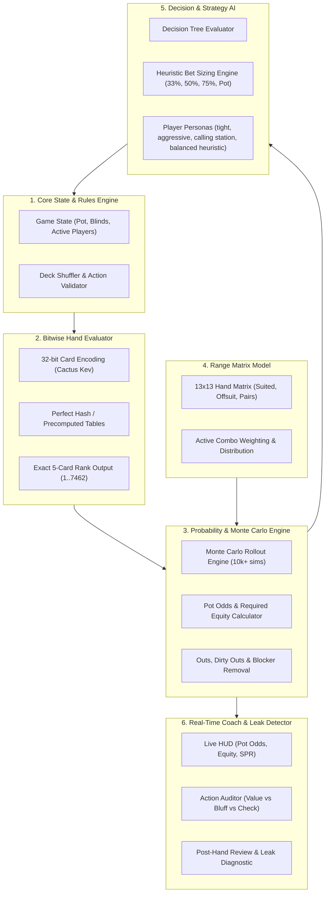
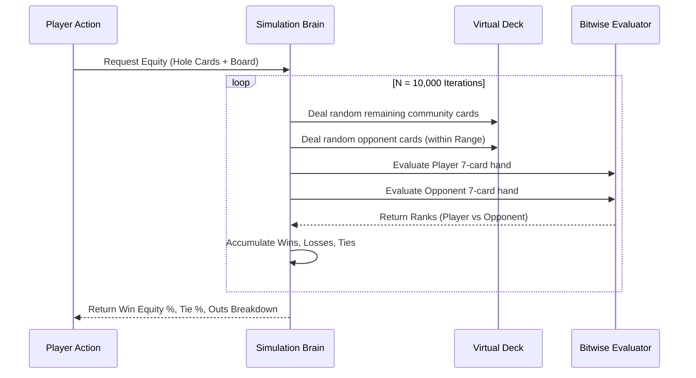
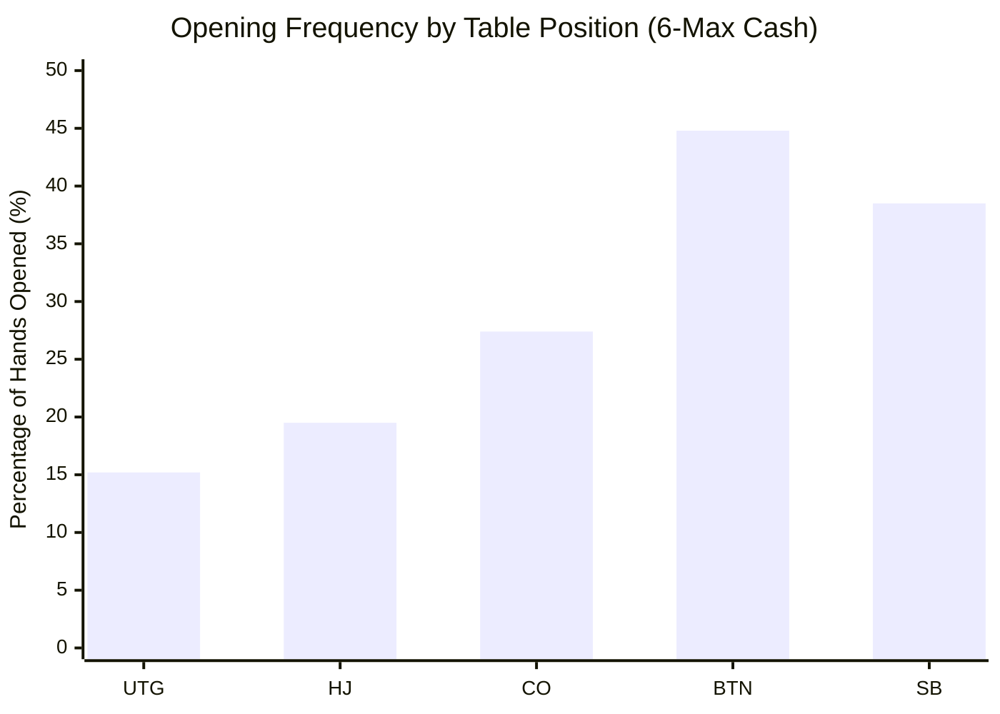
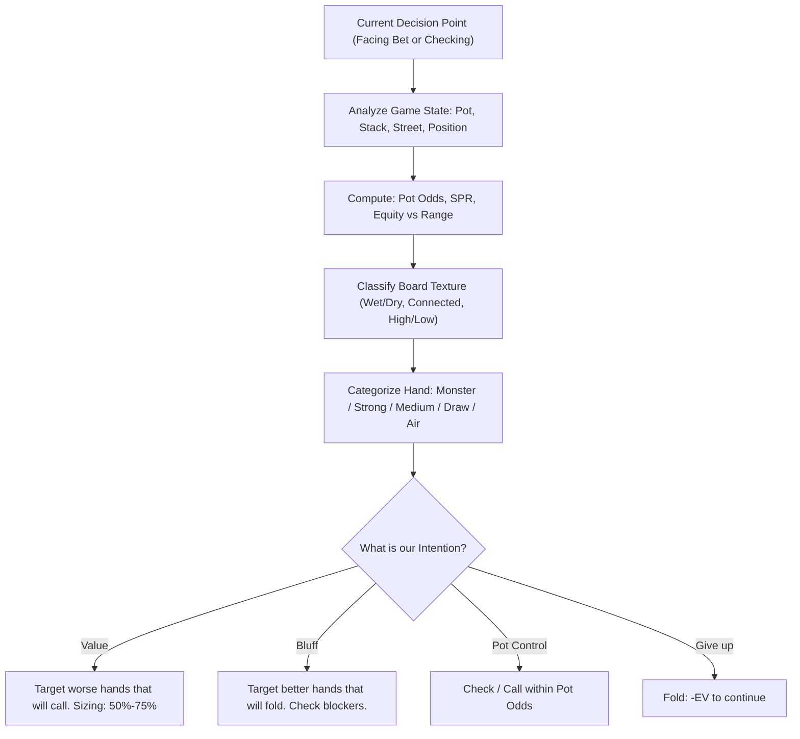
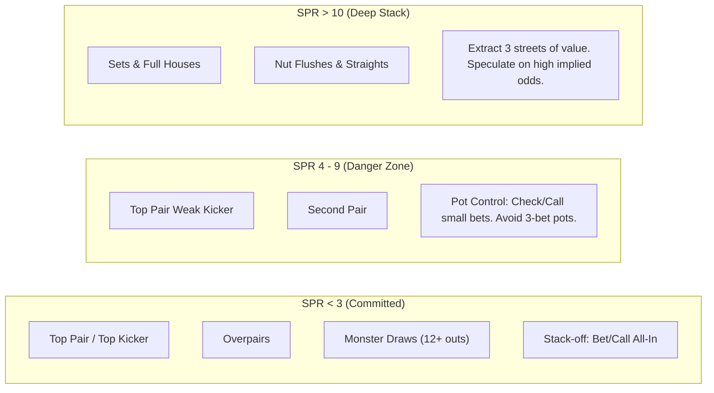

# The Architecture of a Poker Simulator "Brain"
*Technical Design of Hand Evaluation Algorithms, Monte Carlo Equity Engines, Range Modeling, and Decision-Making AI.*

---

## Table of Contents
1. [Architectural Overview & System Decomposition](#1-architectural-overview--system-decomposition)
2. [Card Representation & High-Speed Bitwise Hand Evaluation](#2-card-representation--high-speed-bitwise-hand-evaluation)
3. [The Probability & Monte Carlo Equity Engine](#3-the-probability--monte-carlo-equity-engine)
4. [Range Modeling & Hand Combinatorics](#4-range-modeling--hand-combinatorics)
5. [The Decision Engine: Game Theory, Heuristics & Opponent AI](#5-the-decision-engine-game-theory-heuristics--opponent-ai)
6. [Board Texture Analysis & SPR Integration](#6-board-texture-analysis--spr-integration)
7. [The Coaching Subsystem: Real-Time Auditing & Leak Detection](#7-the-coaching-subsystem-real-time-auditing--leak-detection)
8. [Extensibility for Omaha (PLO) Rules](#8-extensibility-for-omaha-plo-rules)

---

## 1. Architectural Overview & System Decomposition

A sophisticated poker simulator "brain" is fundamentally different from a simple rule engine. It must model **imperfect information**, **continuous game-tree branching**, **probabilistic equity calculations**, and **strategic range equilibrium**.

The architecture is divided into six decoupled, high-performance layers:



---

## 2. Card Representation & High-Speed Bitwise Hand Evaluation

### 2.1 The Need for Speed
In poker simulations, calculating equity requires evaluating the showdown value of thousands of randomly completed boards in fractions of a second. A naive evaluation comparing lists of cards takes hundreds of CPU cycles per hand. A sophisticated brain uses **bitwise integer representations** to evaluate hands in single-digit nanoseconds.

### 2.2 The 32-bit Integer Card Representation (Cactus Kev Standard)
Each of the 52 cards in the deck is represented by a single 32-bit unsigned integer:

```
+--------+--------+--------+--------+
|xxxbbbbb|bbbbbbbb|cdhsrrrr|xxpppppp|
+--------+--------+--------+--------+
   Byte 3   Byte 2   Byte 1   Byte 0
```

Where:
* **Byte 0 (`xxpppppp`):** The prime number corresponding to the rank (2=2, 3=3, 4=5, 5=7, 6=11, 7=13, 8=17, 9=19, T=23, J=29, Q=31, K=37, A=41).
* **Byte 1 (`cdhsrrrr`):** 
  * `cdhs`: 4 bits representing the suit (bit 15 = Clubs, bit 14 = Diamonds, bit 13 = Hearts, bit 12 = Spades).
  * `rrrr`: 4 bits representing the rank index ($0 = \text{Deuce}$ through $12 = \text{Ace}$).
* **Bytes 2 & 3 (`xxxbbbbbbbbbbbbb`):** A 16-bit bitmask where exactly one bit is set corresponding to the card's rank (bit 16 for 2, bit 17 for 3, ..., bit 28 for Ace).

#### Why this structure is pure genius:
1. **Instant Flush Detection:**
   Bitwise AND the suit masks of all 5 cards:
   $$\text{suit\_mask} = C_1 \ \& \ C_2 \ \& \ C_3 \ \& \ C_4 \ \& \ C_5 \ \& \ \text{0xF000}$$
   If $\text{suit\_mask} \neq 0$, all five cards share the same suit. It is a flush!
2. **Instant Unique Rank Fingerprint:**
   Because every rank is assigned a prime number, multiplying the prime bytes of all 5 cards produces a **unique product** for every combination of ranks:
   $$\text{Product} = p_1 \times p_2 \times p_3 \times p_4 \times p_5$$
   Due to the Fundamental Theorem of Arithmetic, this product is invariant to card order and uniquely identifies pairs, three-of-a-kinds, full houses, and high card combinations.

### 2.3 Evaluation Hierarchy (1 to 7,462)
In Texas Hold'em, there are $\binom{52}{5} = 2,598,960$ possible 5-card hands. However, many hands are strategically identical (e.g., $A\spadesuit K\spadesuit Q\spadesuit J\spadesuit T\spadesuit$ is identical in rank to $A\heartsuit K\heartsuit Q\heartsuit J\heartsuit T\heartsuit$).

There are exactly **7,462 distinct hand ranks**:
* Rank 1: Royal Flush (Strongest)
* Rank 2 to 10: Straight Flushes
* Rank 11 to 166: Four of a Kind
* Rank 167 to 322: Full Houses
* Rank 323 to 1599: Flushes
* Rank 1600 to 1609: Straights
* Rank 1610 to 2467: Three of a Kind
* Rank 2468 to 3325: Two Pair
* Rank 3326 to 6185: One Pair
* Rank 6186 to 7462: High Card (Weakest)

```python
# Conceptual Python Implementation of 5-card Evaluator
def evaluate_5_cards(c1, c2, c3, c4, c5):
    # Check for flush
    if (c1 & c2 & c3 & c4 & c5 & 0xF000):
        # Look up bitmask of ranks in flushes table
        rank_mask = (c1 | c2 | c3 | c4 | c5) >> 16
        return flush_lookup_table[rank_mask]
    
    # Check for straight or high card
    rank_mask = (c1 | c2 | c3 | c4 | c5) >> 16
    if rank_mask in straight_or_high_card_table:
        return straight_or_high_card_table[rank_mask]
    
    # Non-flush / non-straight: compute prime product
    prime_product = (c1 & 0xFF) * (c2 & 0xFF) * (c3 & 0xFF) * (c4 & 0xFF) * (c5 & 0xFF)
    return prime_hash_table[prime_product]
```

### 2.4 7-Card Evaluation (Hold'em Best Hand)
To find the best hand for a player holding 2 hole cards with a 5-card board:
$$\binom{7}{5} = 21 \text{ combinations}$$
The engine evaluates all 21 5-card subsets and takes:
$$\text{Best Hand Rank} = \min_{i \in [1..21]} (\text{Rank}_i)$$
With bitwise lookup, evaluating all 21 combinations takes less than **0.8 microseconds** on modern CPUs.

---

## 3. The Probability & Monte Carlo Equity Engine

### 3.1 Exact Enumeration vs. Monte Carlo Simulation
* **Exact Enumeration:** Simulates every possible combination of remaining deck cards.
  * On the Turn (1 card left): 46 remaining cards. Exact enumeration is instantaneous (46 iterations).
  * On the Flop (2 cards left): $\binom{47}{2} = 1,081$ combinations. Instantaneous.
  * Preflop (5 cards left): $\binom{48}{5} = 1,712,304$ board combinations. Exact calculation takes several seconds per player.
* **Monte Carlo Simulation:** Randomly samples $N$ possible outcomes (e.g., $N = 10,000$ iterations). By the Law of Large Numbers, a 10,000-iteration Monte Carlo rollout converges to within $\pm 0.5\%$ of exact equity in under **30 milliseconds**.

### 3.2 Equity Calculation Formulation
For Player $A$ with hole cards $H_A$ versus Opponent $B$ with hole cards $H_B$ across board $B$:

$$\text{Equity}(A) = \frac{\sum_{i=1}^N \left( \mathbf{1}_{\text{Rank}_A < \text{Rank}_B} + 0.5 \times \mathbf{1}_{\text{Rank}_A = \text{Rank}_B} \right)}{N}$$

Where:
* $\text{Rank}_A < \text{Rank}_B$ denotes Player $A$ has a stronger hand (since 1 is best).
* $\mathbf{1}$ is the indicator function.
* Split pots (ties) award exactly half equity (0.5).



### 3.3 Card Removal & Blockers (Lesson 22 from Study Companion)
The equity engine accounts for **blockers**:
* If you hold the $A\spadesuit$, your opponent **cannot** hold $A\spadesuit A\heartsuit$, $A\spadesuit K\spadesuit$, or the nut spade flush.
* This removes specific combinations from their range:
  * Holding an Ace reduces their possible Ace-King offsuit combos from 16 to 12.
  * Holding a pocket pair reduces their set potential on the board.

---

## 4. Range Modeling & Hand Combinatorics

### 4.1 The $13 \times 13$ Hand Matrix
A sophisticated poker AI does not think: *"My opponent has Ace-Jack."* It thinks: *"My opponent's range in this position consists of 18.4% of all hands."*

All 1,326 starting combinations are mapped onto a symmetrical $13 \times 13$ grid:

```
        A     K     Q     J     T     9     8     7     6     5     4     3     2
     +-----+-----+-----+-----+-----+-----+-----+-----+-----+-----+-----+-----+-----+
  A  | AA  | AKs | AQs | AJs | ATs | A9s | A8s | A7s | A6s | A5s | A4s | A3s | A2s |
     +-----+-----+-----+-----+-----+-----+-----+-----+-----+-----+-----+-----+-----+
  K  | AKo | KK  | KQs | KJs | KTs | K9s | K8s | K7s | K6s | K5s | K4s | K3s | K2s |
     +-----+-----+-----+-----+-----+-----+-----+-----+-----+-----+-----+-----+-----+
  Q  | AQo | KQo | QQ  | QJs | QTs | Q9s | Q8s | Q7s | Q6s | Q5s | Q4s | Q3s | Q2s |
     +-----+-----+-----+-----+-----+-----+-----+-----+-----+-----+-----+-----+-----+
  J  | AJo | KJo | QJo | JJ  | JTs | J9s | J8s | J7s | J6s | J5s | J4s | J3s | J2s |
     +-----+-----+-----+-----+-----+-----+-----+-----+-----+-----+-----+-----+-----+
  T  | ATo | KTo | QTo | JTo | TT  | T9s | T8s | T7s | T6s | T5s | T4s | T3s | T2s |
     +-----+-----+-----+-----+-----+-----+-----+-----+-----+-----+-----+-----+-----+
  9  | A9o | K9o | Q9o | J9o | T9o | 99  | 98s | 97s | 96s | 95s | 94s | 93s | 92s |
     +-----+-----+-----+-----+-----+-----+-----+-----+-----+-----+-----+-----+-----+
```
* **Diagonal (13 cells):** Pocket Pairs ($AA, KK, \dots, 22$) — 6 combinations each = 78 total combos.
* **Upper Right Triangle (78 cells):** Suited hands ($s$) — 4 combinations each = 312 total combos.
* **Lower Left Triangle (78 cells):** Offsuit hands ($o$) — 12 combinations each = 936 total combos.

### 4.2 Standard Opening Ranges by Position (6-Max Cash)



* **UTG (~15% of hands):** $77+$, $ATs+$, $KJs+$, $QJs$, $JTs$, $AQo+$.
* **Cutoff (~27% of hands):** $22+$, $A2s+$, $KTs+$, $QTs+$, $J9s+$, $T8s+$, $98s$, $87s$, $ATo+$, $KJo+$.
* **Button (~45% of hands):** Any pair, almost all suited Aces and Kings, suited connectors down to $54s$, one-gappers, broadway offsuits down to $K8o, Q9o, J9o$.

---

## 5. The Decision Engine: Game Theory, Heuristics & Opponent AI

The simulator brain makes decisions through a tiered strategy engine:



### 5.1 The Mathematical Decision Boundary
When facing a bet $B$ into pot $P$:
1. Calculate Required Equity:
   $$\text{ReqEquity} = \frac{B}{P + B + B}$$
2. Calculate Realized Equity $\text{Eq}$ from the Monte Carlo engine.
3. Apply Decision Boundary:
   * If $\text{Eq} \ge \text{ReqEquity} + \text{Threshold}_{\text{position}}$, **Call or Raise**.
   * If $\text{Eq} < \text{ReqEquity}$, **Fold**, unless bluff-raise equity exceeds threshold:
     $$\text{BluffEV} = (\text{FoldEquity} \times P) + (1 - \text{FoldEquity}) \times (\text{Eq} \times (P + 2B_{\text{raise}}) - B_{\text{raise}})$$

### 5.2 Opponent AI Personas

The simulator includes distinct AI player profiles:

| AI Persona | Preflop VPIP / PFR | C-Bet Frequency | Bluff Frequency | Strategic Description |
| :--- | :--- | :--- | :--- | :--- |
| **Nit (Rock)** | 12% / 10% | 75% on dry boards | < 5% | Plays only premium hands. Folds instantly to aggression unless holding monsters. |
| **Calling Station (Fish)** | 48% / 8% | 30% | < 2% | Calls almost any bet with any pair or draw. Never bluffs. Exploit: Pure value betting. |
| **TAG (Tight-Aggressive)** | 21% / 18% | 65% | 20% | Disciplined hand selection; bets aggressively for value and with equity draws. |
| **LAG (Loose-Aggressive)** | 28% / 24% | 72% | 35% | Puts relentless pressure on opponents; utilizes position and blockers to run multi-street bluffs. |
| **Balanced heuristic baseline** | Adaptive | Profile-configured | Heuristic only | A simple configurable baseline; it is not a solver and makes no optimality claim. |

---

## 6. Board Texture Analysis & SPR Integration

### 6.1 Board Texture Classification
The brain evaluates community cards using four orthogonal metrics:
1. **Paired Status:** Unpaired, Paired ($K\text{-}K\text{-}4$), Trips ($7\text{-}7\text{-}7$).
2. **Suit Connectivity:**
   * **Rainbow:** 3 different suits on flop (low flush threat).
   * **Two-tone:** 2 cards of same suit (standard flush draw present).
   * **Monotone:** 3 cards of same suit (flush completed or high danger).
3. **Rank Connectivity:**
   * **Dry / Disconnected:** e.g., $K\spadesuit 8\heartsuit 2\diamondsuit$ (no straight draws possible).
   * **Wet / Dynamic:** e.g., $J\spadesuit T\heartsuit 9\diamondsuit$ or $8\heartsuit 7\heartsuit 6\diamondsuit$ (massive wraps, straights, and flush draws).

### 6.2 SPR-Driven Commitment Matrix (Lesson 20)
$$\text{SPR} = \frac{\text{Effective Stack}}{\text{Flop Pot}}$$



---

## 7. The Coaching Subsystem: Real-Time Auditing & Leak Detection

To function as a true training companion (embodying Lessons 04–10 and 24 of the Champion's guide), the brain runs an **Action Auditor** alongside the gameplay:

### 7.1 Real-Time Coach Metrics Displayed on UI
* **Live Pot Odds:** Displays the exact threshold (e.g., `"Need 28.5% equity to call"`).
* **Current Hand Equity:** Real-time Monte Carlo estimation against opponent's positional range.
* **Mathematical Expected Value ($\Delta \text{EV}$):** Quantifies whether your selected action was $+EV$ or $-EV$ in big blinds ($bb$).
* **SPR Alert:** Warns when you are overplaying medium-strength hands in high-SPR situations.

### 7.2 Automated Leak Detector
After every session, the brain analyzes your decisions for common beginner errors:
1. **Calling Station Leak:** Calling bets when Hand Equity < Pot Odds without sufficient implied odds.
2. **Aimless Betting Leak:** Betting with medium showdown value on wet boards (turning made hands into bluffs without reason).
3. **Out-of-Position Over-defense:** Playing too many marginal hands from the Small Blind.
4. **Tilt Warning:** Detecting sudden spikes in VPIP (playing > 40% of hands after losing a large pot).

---

## 8. Extensibility for Omaha (PLO) Rules

Although initialized for Texas Hold'em (Bridge Phase), the brain's architecture is built to support **4-Card Pot-Limit Omaha (PLO)** as required by Stage 3 (Lessons 11–22):

1. **Strict 2-from-4 Combination Rule:**
   For each PLO hand:
   $$\binom{4}{2} \text{ (hole combinations)} \times \binom{5}{3} \text{ (board combinations)} = 6 \times 10 = 60 \text{ combinations}$$
   The evaluator tests all 60 combinations using the same bitwise 5-card rank engine.
2. **Pot-Limit Sizing Enforcement:**
   $$\text{Max Legal Raise} = \text{Current Pot} + 2 \times (\text{Amount to Call})$$
   (Directly implements Lesson 12 arithmetic).
3. **Wrap & Nut Potential Detection:**
   Counts 9, 13, 17, and 20-out straight draws and separates **nut outs** from **dirty outs** (Lessons 18 & 19).
