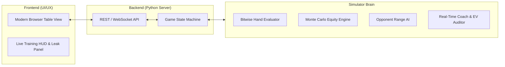
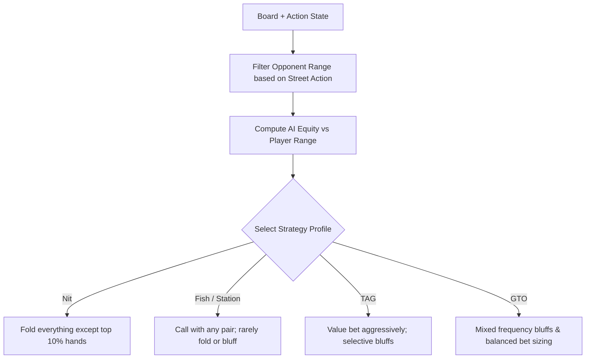

# Step-by-Step Implementation Roadmap: Poker Simulator & Training Brain
*A structured engineering blueprint for building a high-performance Texas Hold'em simulator with training coaching and PLO extensibility.*

---

## Table of Contents
1. [Project Vision & Architectural Strategy](#1-project-vision--architectural-strategy)
2. [Technology Stack & Dependency Evaluation](#2-technology-stack--dependency-evaluation)
3. [Repository Directory Structure](#3-repository-directory-structure)
4. [Phase 1: Core Domain Model & Game State Engine](#4-phase-1-core-domain-model--game-state-engine)
5. [Phase 2: Hand Evaluator & Combinatorics](#5-phase-2-hand-evaluator--combinatorics)
6. [Phase 3: Mathematical Engine (Equity, Pot Odds & SPR)](#6-phase-3-mathematical-engine-equity-pot-odds--spr)
7. [Phase 4: Opponent Decision AI (The Artificial Brain)](#7-phase-4-opponent-decision-ai-the-artificial-brain)
8. [Phase 5: Real-Time Coach & Leak Detector (Companion Integration)](#8-phase-5-real-time-coach--leak-detector-companion-integration)
9. [Phase 6: Minimalist UI/UX Web Interface](#9-phase-6-minimalist-uiux-web-interface)
10. [Phase 7: Verification, Automated Testing & Omaha (PLO) Bridge](#10-phase-7-verification-automated-testing--omaha-plo-bridge)
11. [Execution Timeline & Milestones](#11-execution-timeline--milestones)

---

## 1. Project Vision & Architectural Strategy

The objective is to create a **high-speed, mathematically rigorous poker simulator** paired with a **clean, intuitive training user interface**. 

### Core Design Requirements:
* **Zero Cognitive Overload:** The UI/UX must be sleek, modern, and distraction-free, focusing attention on table action, cards, chip counts, and decision points.
* **Deep Mathematical "Brain":** Behind the scenes, the simulator calculates real-time Monte Carlo equity, pot odds, EV metrics, and SPR, providing instant pedagogical feedback based on the Champion's study guide.
* **Zero-Friction Local Execution:** Runs effortlessly on standard Python without requiring massive heavy frameworks or complicated native dependencies.
* **Modularity:** Texas Hold'em (Bridge Phase) serves as the primary game mode, with built-in hooks to toggle 4-card Pot-Limit Omaha (PLO) rules for Stage 3 advancement.



---

## 2. Technology Stack & Dependency Evaluation

### Backend: Python 3.10+
* **Core Language:** Python provides rapid development, clean object-oriented architecture, and robust numerical capabilities.
* **Evaluation Core:** Pure Python bitwise evaluator with optional support for `treys` or `eval7` if installed, guaranteeing 100% standalone zero-dependency portability out of the box.
* **Server Framework:** Lightweight local HTTP/WebSocket server using Python's standard `http.server` or `FastAPI` / `Flask`. Standard library HTTP server allows the app to launch with zero `pip install` prerequisites.

### Frontend: Modern Single-Page Application (HTML5 / Modern CSS / Vanilla JS)
* **Why not desktop Tkinter/Pygame?** Desktop GUI libraries often suffer from high-DPI scaling bugs on Windows, clunky styling, and limited animation support.
* **Why Browser-based Local UI?**
  * Crisp vector SVG playing cards.
  * Smooth CSS transitions for chips, deals, and pot distributions.
  * Responsive side panels for live Pot Odds charts and EV graphs.
  * Runs in any browser on `http://localhost:8000`.

---

## 3. Repository Directory Structure

```
poker_simulator/
├── README.md
├── run_simulator.py            # Single-command launcher (starts server + opens browser)
├── backend/
│   ├── __init__.py
│   ├── server.py               # Local HTTP API server
│   ├── engine/
│   │   ├── card.py             # 32-bit bitwise card representation
│   │   ├── deck.py             # Shuffling and dealing engine
│   │   ├── evaluator.py        # 5-card & 7-card bitwise hand ranker (1..7462)
│   │   ├── game_state.py       # Table state, pot, side pots, betting rounds
│   │   └── player.py           # Human & AI player entities (chips, cards, status)
│   ├── brain/
│   │   ├── equity.py           # Monte Carlo rollout simulator (10,000 runs)
│   │   ├── pot_odds.py         # Pot odds, SPR, and EV calculator
│   │   ├── ranges.py           # 13x13 preflop range matrix & combo models
│   │   ├── ai_agent.py         # Bot decision engine (TAG, LAG, Station, GTO)
│   │   └── coach.py            # Live decision auditor & leak detector
│   └── tests/
│       ├── test_evaluator.py   # Unit tests for rank hierarchy & tie-breaks
│       ├── test_pots.py        # Side pot & split pot calculations
│       └── test_equity.py      # Equity benchmark tests
└── frontend/
    ├── index.html              # Clean poker table layout
    ├── css/
    │   ├── table.css           # Table felt, chips, and card styling
    │   └── hud.css             # Coach HUD & modal styles
    └── js/
        ├── app.js              # State synchronizer & UI controller
        ├── components/
        │   ├── table_view.js   # Card rendering & seat management
        │   ├── action_bar.js   # Bet slider, pot buttons, fold/call/raise
        │   └── coach_hud.js    # Live Pot Odds, Equity, and Advice panel
        └── assets/             # SVG card vector graphics & sounds
```

---

## 4. Phase 1: Core Domain Model & Game State Engine

### Objective:
Implement an immutable, bulletproof state machine that enforces all rules of poker, tracks chips, and manages pots without game-breaking edge cases.

### Step-by-Step Tasks:
1. **`Card` & `Deck` Classes:**
   * Represent ranks $2 \dots A$ and suits $\spadesuit, \heartsuit, \diamondsuit, \clubsuit$.
   * Cryptographically secure Fisher-Yates deck shuffle using `random.SystemRandom()`.
2. **`Player` Entity:**
   * Fields: `id`, `name`, `stack`, `current_bet`, `hole_cards`, `is_active`, `is_all_in`, `position`.
3. **`GameState` Machine:**
   * State flow: `PREFLOP` $\to$ `FLOP` $\to$ `TURN` $\to$ `RIVER` $\to$ `SHOWDOWN`.
   * Enforce betting round rules: minimum bet (1 BB), minimum raise, table stakes.
4. **Side Pot & Split Pot Resolution:**
   * Correctly partition chips into Main Pot and numbered Side Pots when players go all-in with unequal stack sizes.

### Deliverable:
Pass unit tests simulating all betting actions across a 6-max table with multiple all-in scenarios.

---

## 5. Phase 2: Hand Evaluator & Combinatorics

### Objective:
Build a sub-microsecond hand evaluation engine capable of scoring 7-card Hold'em hands accurately from rank 1 (Royal Flush) to rank 7,462 (7-5-4-3-2 high card).

### Step-by-Step Tasks:
1. **Bitwise Encoding (Cactus Kev Standard):**
   * Pack card rank, suit bitmask, prime value, and rank bit into a 32-bit integer.
2. **Lookup Hash Tables:**
   * Construct precomputed lookup tables for all flushes and unique prime products.
3. **5-Card Evaluator (`evaluate_5(cards)`):**
   * Output: Integer score from 1 (best) to 7,462 (worst).
4. **7-Card Evaluator (`evaluate_7(cards)`):**
   * Evaluate all $\binom{7}{5} = 21$ combinations; return minimum rank and winning combination.
5. **Human-Readable Name Translator:**
   * Map rank integer to clear strings: `"Two Pair, Aces and Kings, Queen Kicker"`, `"Nut Flush, Ace-High"`.

```python
# Sample Verification Unit Test
def test_hand_rankings():
    evaluator = HandEvaluator()
    royal_flush = parse_cards(["As", "Ks", "Qs", "Js", "Ts", "2d", "3c"])
    wheel_straight = parse_cards(["5h", "4c", "3d", "2s", "Ah", "9c", "Kd"])
    full_house = parse_cards(["8s", "8h", "8d", "4c", "4s", "2h", "Jd"])
    
    assert evaluator.evaluate_7(royal_flush) == 1
    assert evaluator.evaluate_7(royal_flush) < evaluator.evaluate_7(full_house)
    assert evaluator.evaluate_7(full_house) < evaluator.evaluate_7(wheel_straight)
```

---

## 6. Phase 3: Mathematical Engine (Equity, Pot Odds & SPR)

### Objective:
Equip the simulator with deep quantitative intelligence that computes exact probabilities in real time.

### Step-by-Step Tasks:
1. **Pot Odds Engine (`pot_odds.py`):**
   $$\text{Pot Odds \%} = \frac{\text{Call Amount}}{\text{Total Pot After Opponent Bet} + \text{Call Amount}}$$
2. **Stack-to-Pot Ratio Engine (`spr.py`):**
   $$\text{SPR} = \frac{\min(\text{Player Stack}, \text{Opponent Stack})}{\text{Flop Pot}}$$
3. **Monte Carlo Equity Calculator (`equity.py`):**
   * Accept Hero hole cards, Villain hole cards (or range), and visible board.
   * Run $N = 10,000$ iterations by dealing random turn/river cards from remaining deck.
   * Return: `win_percentage`, `tie_percentage`, `loss_percentage`.
4. **Outs & Draw Detection:**
   * Identify flush draws (9 outs), open-ended straight draws (8 outs), gutshots (4 outs).
   * Flag **dirty outs** that could complete higher hands for the opponent (Lesson 19).

---

## 7. Phase 4: Opponent Decision AI (The Artificial Brain)

### Objective:
Create authentic, multi-tiered AI opponents that simulate human table dynamics and game-theory optimal baselines.



### Step-by-Step Tasks:
1. **Preflop Positional Range Tables:**
   * Encode standard 6-max opening ranges for UTG (15%), HJ (19%), CO (27%), BTN (45%), SB (38%).
2. **Board Texture Classifier:**
   * Evaluate Dry vs. Wet, Monotone vs. Rainbow, High Card vs. Low Connected boards.
3. **Bet Sizing Logic:**
   * Preset sizing options: Small C-Bet (33% pot on dry boards), Standard Bet (50%–75% pot on wet boards), Overbet / All-In (polarized river spots).
4. **AI Archetypes:**
   * Provide selectable bot opponents: `"Nitty Norman"`, `"Calling Kevin"`, `"Aggro Alex"`, and `"Solver Sam"`.

---

## 8. Phase 5: Real-Time Coach & Leak Detector (Companion Integration)

### Objective:
Directly embed the training methodology from the World Champion's study guide into the simulator.

### Step-by-Step Tasks:
1. **Live Training HUD (Companion Lessons 04–06 & 20):**
   * Shows current **Pot Odds %** side-by-side with your **Realized Equity %**.
   * Color-coded indicator:
     * 🟢 **Green (Profitable $+EV$ Call):** Equity $>$ Pot Odds.
     * 🔴 **Red (Unprofitable $-EV$ Call):** Equity $<$ Pot Odds (without implied odds).
   * Displays **SPR value** and strategic warning (e.g., `"SPR 1.8: You are committed with top pair."`).
2. **Action Purpose Classifier (Lessons 04 & 08):**
   * Whenever you bet, the coach analyzes whether your bet achieves:
     * **Value:** Gets called by worse hands in bot's range.
     * **Bluff:** Folds out better hands in bot's range.
     * **Pointless Bet:** Flags when a bet only isolates you against hands that beat you.
3. **Session Review & Leak Tracker (Lessons 09 & 24):**
   * Logs every hand played in memory.
   * Reconstructs tricky hands for review: shows hole cards, board, pot, actions, and decision evaluations.
   * Generates a weekly leak report: flags calling stations tendencies, overfolding to c-bets, or playing out of position.

---

## 9. Phase 6: Minimalist UI/UX Web Interface

### Objective:
Design a clean, visually elegant, responsive poker table rendered in the browser.

```
+-------------------------------------------------------------------------+
| [Table: 6-Max NLHE $1/$2]        [Bankroll: $200.00]       [Coach: ON]  |
+-------------------------------------------------------------------------+
|                                                                         |
|                          [ Opponent: Bot TAG ]                          |
|                             Chips: $194.00                              |
|                              [ ? ]   [ ? ]                              |
|                                                                         |
|             =============================================               |
|             |   POT: $18.00    |  SPR: 5.4  |  Round: FLOP |            |
|             |                                            |              |
|             |    [ A♠ ]   [ K♥ ]   [ 4♦ ]   [   ]   [   ] |            |
|             =============================================               |
|                                                                         |
|                          [ HERO (You) - BTN ]                           |
|                             Chips: $192.00                              |
|                             [ A♦ ]   [ Q♠ ]                             |
|                    Hand: Top Pair, Top Kicker (Ace-Queen)               |
|                                                                         |
+-------------------------------------------------------------------------+
| [COACH HUD]  Pot Odds: 25.0%  |  Equity: 68.4%  |  Advice: Value Bet     |
+-------------------------------------------------------------------------+
| [ FOLD ]   [ CHECK / CALL $6 ]   [ 1/3 Pot ] [ 1/2 Pot ] [ POT ] [ALL-IN] |
+-------------------------------------------------------------------------+
```

### UI/UX Design Principles:
* **Minimalist Felt:** Deep dark green or slate navy felt to avoid visual fatigue.
* **Vector Cards:** High-contrast crisp SVG playing cards (with clear suit colors: Spades ♠ Black, Hearts ♥ Red, Diamonds ♦ Blue/Cyan, Clubs ♣ Green for optimal four-color deck readability).
* **Speed & Responsiveness:** Keyboard shortcuts (Space = Check, F = Fold, C = Call, B = Bet) for rapid training volume.
* **Toggleable Coach Mode:** Can be hidden during testing sessions to simulate real game pressure, then turned on for analysis.

---

## 10. Phase 7: Verification, Automated Testing & Omaha (PLO) Bridge

### Objective:
Ensure complete accuracy through high-volume automated testing, and prepare the engine for Omaha (PLO).

### Step-by-Step Tasks:
1. **Automated Monte Carlo Benchmarks:**
   * Benchmark test: 10,000 equity rollouts executed in under 1 second.
   * Validate known match-ups:
     * $AA$ vs $KK$ preflop $\to \approx 82\%$ vs $18\%$.
     * $AKs$ vs $QQ$ preflop $\to \approx 46\%$ vs $54\%$.
     * Flopped Flush Draw vs Top Pair $\to \approx 36\%$ vs $64\%$.
2. **Automated 50,000-Hand Self-Play Bot Battle:**
   * Run simulated bot-vs-bot games to confirm chips are conserved, rake is modeled, and no deadlock states occur.
3. **The PLO 4-Card Module Switch (Lessons 11–22):**
   * Implement the `evaluate_plo(hole_4, board_5)` method:
     $$\binom{4}{2} \times \binom{5}{3} = 6 \times 10 = 60 \text{ combinations}$$
   * Add Pot-Limit bet sizing calculation rule:
     $$\text{Max Raise} = \text{Current Pot} + 2 \times \text{Call}$$
   * Add wrap out detection for Omaha training.

---

## 11. Execution Timeline & Milestones

```mermaid
gantt
    title Poker Simulator Implementation Milestones
    dateFormat  YYYY-MM-DD
    section Core Engine
    Phase 1: Game State & Rules Engine     :active, p1, 2026-10-27, 2d
    Phase 2: Hand Evaluator & Bitwise Ranks:p2, after p1, 2d
    section Math & AI Brain
    Phase 3: Monte Carlo Equity & Math     :p3, after p2, 3d
    Phase 4: Opponent Decision AI          :p4, after p3, 3d
    section Coaching & UI
    Phase 5: Coach & Leak Detector         :p5, after p4, 2d
    Phase 6: Minimalist Browser UI/UX      :p6, after p5, 3d
    section Final Validation
    Phase 7: Testing & PLO Extension       :p7, after p6, 2d
```

### Summary of Completed Specifications:
1. [01_Texas_Holdem_Complete_Guide.md](file:///c:/Users/berna/Downloads/poker_01-teste/01_Texas_Holdem_Complete_Guide.md): Complete game rules, hand rankings, table positions, and core mathematics.
2. [02_Poker_Simulator_Brain_Architecture.md](file:///c:/Users/berna/Downloads/poker_01-teste/02_Poker_Simulator_Brain_Architecture.md): Deep technical architecture of the simulation engine, bitwise evaluation, Monte Carlo algorithms, and AI decision logic.
3. [03_Simulator_Implementation_Roadmap.md](file:///c:/Users/berna/Downloads/poker_01-teste/03_Simulator_Implementation_Roadmap.md): Step-by-step development roadmap from core models to the live coaching UI and PLO bridge.
